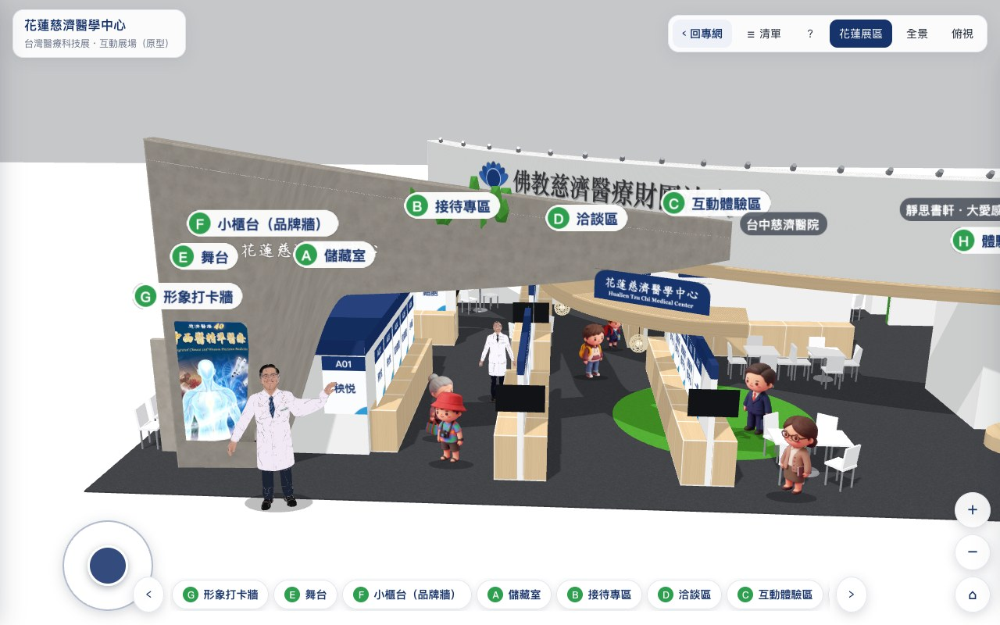
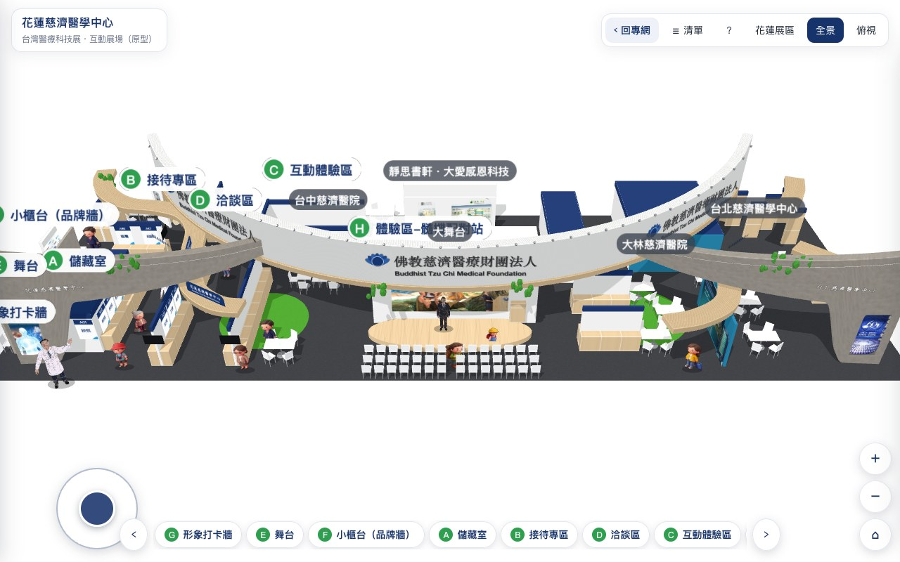
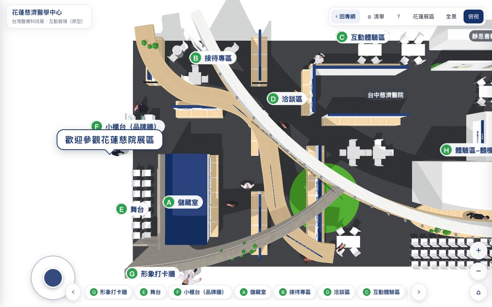
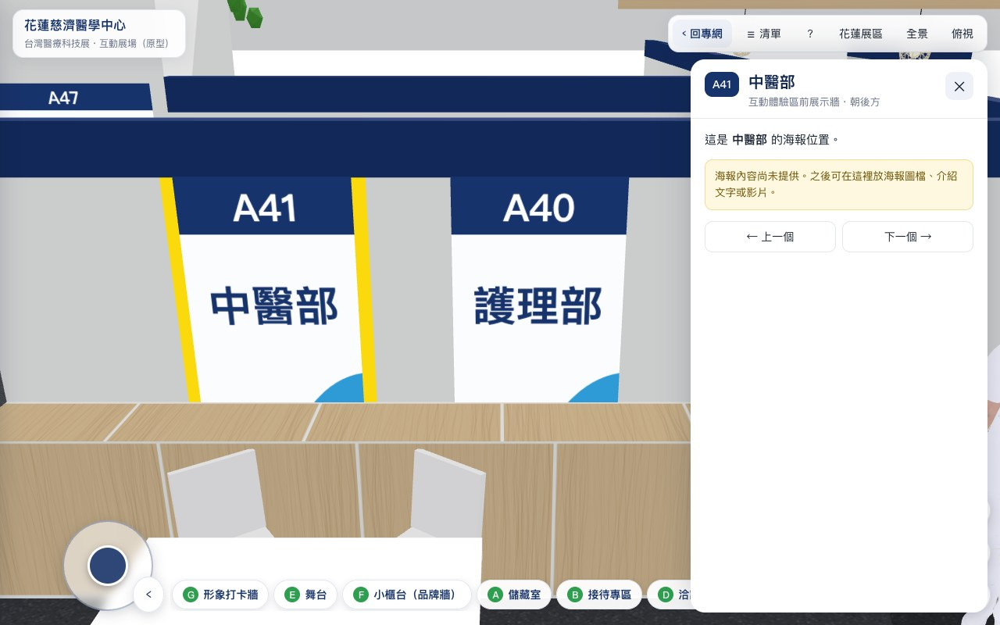
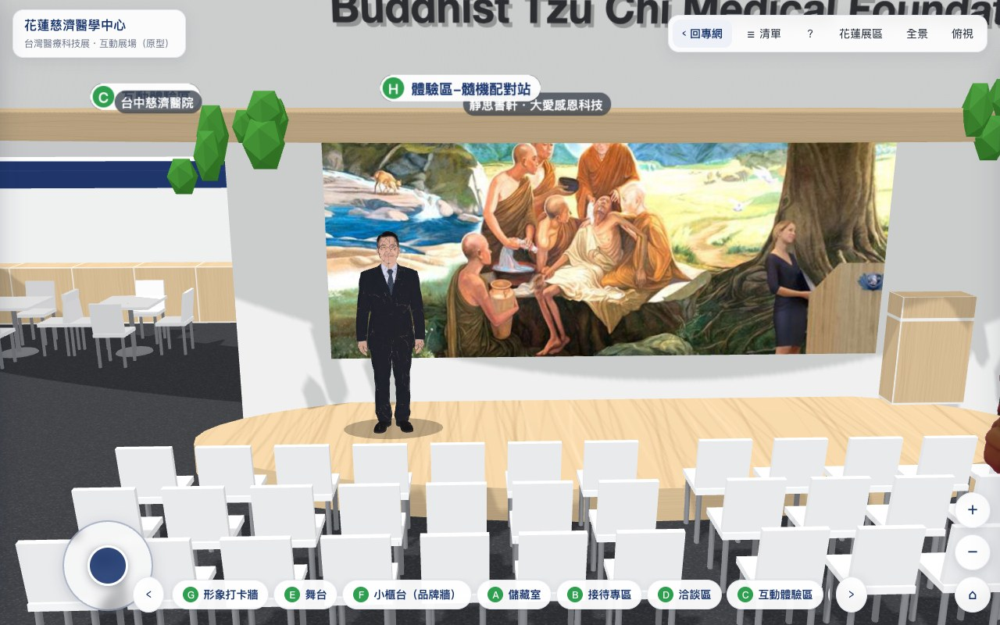
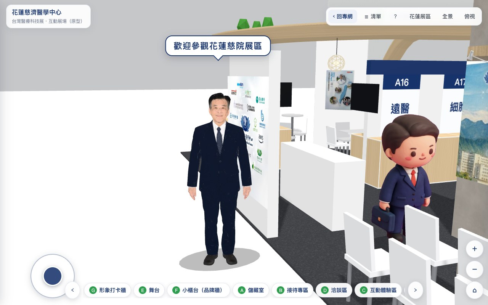
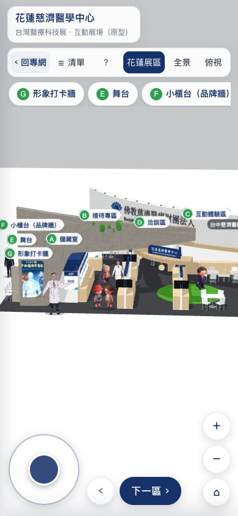
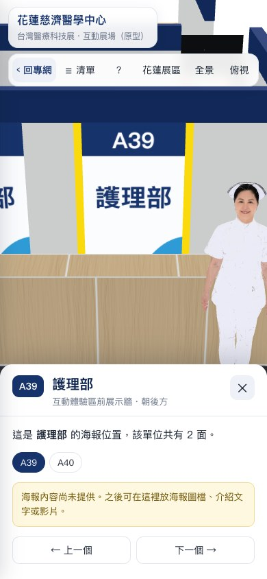

# 2026 台灣醫療科技展・花蓮慈濟醫院展區 3D 互動展場

把花蓮慈濟醫院（佛教慈濟醫療財團法人展位左側）的展區做成可以在瀏覽器裡逛的 3D 展場。訪客可以環視展場、點選海報看介紹、跳到各功能區，並由 5 位 3D 人偶迎賓。

- 技術：單一 `index.html` + three.js（r128），沒有後端、沒有建置工具，靜態檔案就能跑。
- 上線網址：<https://hlm.tzuchi.com.tw/vr/expo2026/>
- 回專網：畫面右上角「‹ 回專網」連到 <https://hlm.tzuchi.com.tw/home/index.php/expo>

## 系統截圖

以下為本機開發版畫面（1280×800 桌機、390×844 手機）。

**首次開啟：林欣榮院長走出來迎賓**


**全景與俯視**

| 全景 | 俯視 |
|---|---|
|  |  |

**點選海報，開資訊卡**


**大舞台上的蔡昇宗副院長**


**品牌牆旁的陳星助副院長（走近或點選會說歡迎詞）**


**手機版：圓形搖桿與「下一區」按鈕**

| 展區畫面 | 海報資訊卡 |
|---|---|
|  |  |

## 功能

**瀏覽**
- 視角：花蓮展區（預設）、全景、俯視；可旋轉、縮放、拖曳。
- 首次開啟：先看全景，停 1 秒後切到花蓮展區（手機直式會直接拉近到前方，讓院長和主管們大一點），林欣榮院長帶著 5 位副院長、主任從走道走出來，一起走到前方，院長說「歡迎參觀花蓮慈院展區」；說完後 5 位各自走回自己的位置（路徑由程式依牆、櫃檯、桌椅自動規劃，不會穿牆）。每次開啟或重新整理都會重播。
- 使用說明：網頁一載入就顯示在畫面下方，停 10 秒後自動收起（點「知道了」會直接收起，之後不再自動顯示；右上「?」可隨時重開）。
- 眼高模式：走進展場以眼睛高度逛，展架會比人高。
- 下方「下一區」按鈕（桌機與手機一樣，只有「‹」「下一區 ›」這一組）會把鏡頭移到該區海報牆的正前方、人眼高度平視（不是從上方俯瞰），各區位置與朝向設定在 `index.html` 的 `ZONE_VIEW`；被牆擋住時會自動拉近。桌機：`W A S D`／方向鍵移動、滑鼠拖曳轉頭。手機：左下角圓形搖桿（類似 Roblox）控制方向與速度，下方「‹ 下一區 ›」按鈕一區一區跳。

**海報與資訊卡**
- 海報位置 A01～A41、A47、A48，加上特殊位置 A42～A46（主視覺、舞台螢幕、舞台側牆圖案、品牌牆、《超仁》書牆）。
- 點海報開資訊卡：標題、介紹文字、影片、海報圖。內容尚未填的會顯示「海報內容尚未提供」。
- 清單可依功能區、展出單位找海報。桌機版不用點：滑鼠移到瀏覽器最右邊，清單就從右側滑出，移開後自動收起（資訊卡開著或拖曳畫面時不會彈出）；右緣有「◂ 清單」小標籤提示，上方「☰ 清單」按鈕也仍可點。手機版從左側開啟。

**功能區（代號沿用平面圖，清單與「下一區」按走動動線排序）**
G 形象打卡牆 → E 舞台 → F 小櫃台（品牌牆）→ B 接待專區 → C 互動體驗區 → H 體驗區-髓機配對站（原平面圖的 A 儲藏室、D 洽談區不放進清單與「下一區」）

**人偶（皆為 3D 模型，無骨架，動作由程式驅動；共 6 位）**

| 人偶 | 位置 | 行為 |
|---|---|---|
| 林欣榮院長 | 展區入口（打卡牆前） | 每次開啟走出來、舉手揮動、說「歡迎參觀花蓮慈院展區」 |
| 吳彬安副院長 | 前方中央展示牆，A24 旁 | 面向鏡頭；點他說「歡迎參觀AI中心攤位」 |
| 蔡昇宗副院長 | 大舞台左側 | 站著，偶爾走動；點他說「歡迎參觀花蓮慈院攤位」 |
| 陳星助副院長 | 左側走道，品牌牆旁 | 面向鏡頭；走近或點選說「歡迎參觀花蓮慈院展區」 |
| 鍾惠君主任 | 護理部 A39 旁 | 面向鏡頭；點她說「歡迎參觀護理部攤位」 |
| 李啟誠副院長 | A14、A15（國醫中心）海報前 | 站著、偶爾在海報前走幾步；點他說「歡迎參觀國醫中心攤位」 |

另有 10 位黏土風民眾在展場走動（不可點選）。

## 目錄結構

```
23_expo/
├── site/                 開發版（改這裡）
│   ├── index.html        主程式（場景、互動、人偶全部在這一個檔）
│   ├── content.js        海報標題／文字／影片設定
│   ├── assets/           貼圖、3D 人偶（*.glb）、民眾圖（people/）
│   ├── posters/          海報圖檔放這裡
│   └── index_v14…v21_*.html   歷史備份
├── expo-deploy/          上傳用的部署版（由 build_deploy.py 產生）
│   └── js/               three.js、OrbitControls、GLTFLoader（本機版，不依賴外網）
├── expo-deploy.zip       部署版壓縮檔
├── docs/screenshots/     README 用的系統截圖
├── source_assets/        人偶原始高解析 .glb
├── tools/simplify_glb.py 把 Meshy 原始 .glb 縮減成網頁用小檔
├── tools/slim_glb.py     再瘦身：拿掉法線、16 位元索引、重壓貼圖（約 1.5 MB → 0.9 MB）
├── build_deploy.py       site/ → expo-deploy/
├── update_poster_list.py 更新海報檔名清單
├── 更新說明.md            給負責更新海報的人看的簡短說明
└── *.png／*.pdf／*.jpg    設計圖、平面圖、邀請卡（原始素材）
```

## 本機預覽

```bash
python3 -m http.server 8766 --directory site
```

開啟 <http://localhost:8766/>。（也可用 `.claude/launch.json` 的 `expo-3d`／`expo-deploy` 設定啟動。）
需要連網載入 three.js 的是開發版；`expo-deploy/` 已改用本機 `js/`，可離線。

## 更新海報內容

1. 海報圖檔放進 `posters/`，檔名用編號，例如 `A01.jpg`、`A18-1.png`。
2. 在 `content.js` 填 `title`、`text`（換段落用 `\n`）、`video`（影片檔名，同樣放在 `posters/`）。
3. 執行 `python3 update_poster_list.py`，把 `posters/` 裡的檔名寫進 `content.js`（正式伺服器不提供資料夾清單，這步不能省）。預設處理 `expo-deploy/`，也可指定資料夾。
4. 重新上傳 `content.js` 與 `posters/`。

**海報上的電視色塊**：廠商圖上標示「43"TV」「65"TV」的色塊，現場其實是電視。程式會在那個位置畫一台有厚度的電視（黑色機身與邊框、玻璃反光、指示燈），螢幕輪播展區圖片（預設：中西醫主視覺、人本醫療、舞台橫幅，每張 6 秒淡入淡出；可用 `window.TV_SLIDES = ["posters/A42.jpg", …]` 改成實際電視播放的內容），蓋在圖上，預設 A01、A43。位置用圖片的比例座標 `[左, 上, 右, 下]`（0～1），可在 `content.js` 用 `window.TV_AREAS = { A01: [.199, .188, .577, .399] };` 覆寫或新增，寫成 `window.TV_AREAS = {};` 就全部不畫。資訊卡裡顯示的仍是廠商的原圖。

**特殊位置 A42–A46**（主視覺、舞台螢幕、舞台側牆圖案、品牌牆、《超仁》書牆）：`posters/` 放同編號的圖檔（如 `A42.jpg`、`A43.jpg`）就會取代預設的設計圖貼圖；資訊卡也會顯示這張圖，並可在 `content.js` 填 `"A42"` 的標題、文字、影片。圖片比例與位置不同時，同樣依圖片比例等比例顯示。

**一張大圖貼在相鄰攤位（合併海報組）**：廠商只給一張圖、現場貼在兩個攤位時，在 `content.js` 設定
`window.MERGE = [["A02", "A03"]];`。畫面上這兩格會畫成一張寬海報（標題條顯示「A02～A03」），點任一格都開同一張資訊卡；圖檔用組內任一個編號當檔名皆可（`posters/A02.jpg`、`A18.jpg`…），文字寫在組內任一個編號都會顯示（取第一個有填的）。寬度依兩格的實際位置自動計算，圖片比例約 1.5：1（兩格各 90×125 公分並排）。不寫 `MERGE` 時使用程式內的預設組合（A02～A03、A04～A05、A18-1～A19、A20-1～A21、A33～A36、A37～A38、A39～A40）；寫成 `window.MERGE = [];` 就全部不合併。可一次列多組、一組可超過兩個（需同一面、同一道牆）。

骨髓中心的 A47、A48 已使用廠商圖檔（約 3500×1536 的寬幅橫圖，縮成最長邊 2400px、品質 80，原檔在 `posters_original/`）。其文字條目在開發版 `content.js` 仍是空白；**伺服器上的 `content.js` 是你自己維護的版本，部署時不會覆蓋**，要補條目請直接編輯那份。

## 部署

1. 建置：
   ```bash
   python3 build_deploy.py
   ```
   會重建 `expo-deploy/` 與 `expo-deploy.zip`：把 CDN 的程式庫換成本機 `js/`、只複製 `index.html` 有用到的圖檔與模型、設好檔案權限。不會動 `expo-deploy/` 裡的 `posters/` 與 `content.js`。
2. 先模擬上傳（`-n`）確認內容：
   ```bash
   rsync -rltnz --exclude='.DS_Store' --exclude='content.js' --exclude='posters/' \
     expo-deploy/ <帳號>@<內網伺服器>:/var/www/html/hualien/vr/expo2026/
   ```
3. 確認無誤後拿掉 `-n` 正式上傳。
4. 驗證（本機不能直接連網域，用 `--resolve` 指到伺服器 IP）：
   ```bash
   curl -sk --resolve hlm.tzuchi.com.tw:443:<伺服器IP> https://hlm.tzuchi.com.tw/vr/expo2026/
   ```

注意：
- 不要加 `--delete`；macOS 內建 rsync 不支援 `--chmod`（`build_deploy.py` 已先把權限設為 644／755，否則 Apache 會回 403）。
- 伺服器位址、帳號為內部資訊，未寫在此檔。伺服器只開 443。

## 人偶與 3D 模型

- 網站用的是縮減過的模型：`assets/director3d.glb`、`vice3d.glb`、`tsai3d.glb`、`chen3d.glb`、`chung3d.glb`、`li3d.glb`（各約 0.3～1.6 MB，約 4 萬面、1024 貼圖）。
- 原始高解析模型在 `source_assets/`（約 6～38 MB）。要換新模型或重新縮減，從這裡來；縮減用 `tools/simplify_glb.py`（用法寫在檔頭，會把模型正規化成高 1.9、腳底在 y=-0.95，並印出左右寬度分佈判斷手臂是否張開）。
- 模型沒有骨架。程式（`makeRig()`）依手臂、雙腿、頭的區域直接移動模型表面：走路擺腿、舉手揮動、抬頭看鏡頭。
- 林院長的模型手臂是微微張開的 A 字姿勢，可以舉手揮動。其他幾位手臂貼著身體，只能整隻手臂往前抬，**無法**像院長那樣揮手；往外張會把袖子撕開。若要更自然的手部動作，需要重新生成手臂張開的模型。
- 換人偶時要調整：`index.html` 裡對應人偶的程式區塊（位置、點選時的話）。

## 載入速度

- 人偶模型約 4.4 MB（6 位）、民眾圖 0.2 MB（WebP）。網頁會**先載入院長**，院長載好才載其他 5 位，再慢的網路也先看到院長走出來。
- 民眾（客人）的圖片載入前不會顯示（以前會先出現空白的長方形）；民眾圖也在網頁一開始就預先載入。
- 我用 3 Mbps、延遲 80 ms 模擬慢網：展場約 6 秒出現、民眾約 8 秒到齊、院長約 8 秒、其餘 5 位約 26 秒內陸續出現。

## 已知限制

- 手機實機的操作手感（搖桿大小、轉頭靈敏度）與效能尚未在多款真機上測試。
- 台北慈濟醫學中心展位朝北的深藍招牌是自行設計的（設計圖沒有這一面）。
- 大舞台後牆的「人醫仁心」照片牆是從設計圖裁出的圖，近看會有顆粒；有高解析原圖可換 `assets/t_photowall_c.jpg`。
- 中央白色展間的內部小隔間、舞台兩側素面牆等處目前仍是素色。
- 海報內容（圖檔、文字、影片）由展覽團隊自行補上。

## 素材來源

展場外觀、配色、貼圖來自設計圖 `00expo_total.pdf`（第四次修改圖面）與 `展場3D圖-01～03.png`、`02expo_hualien-*.png`。人偶來自 Meshy 生成的 3D 模型。
